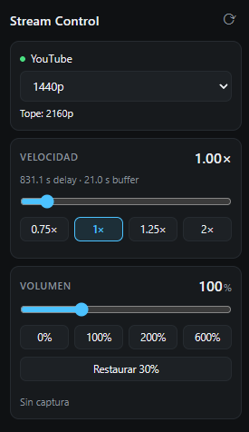
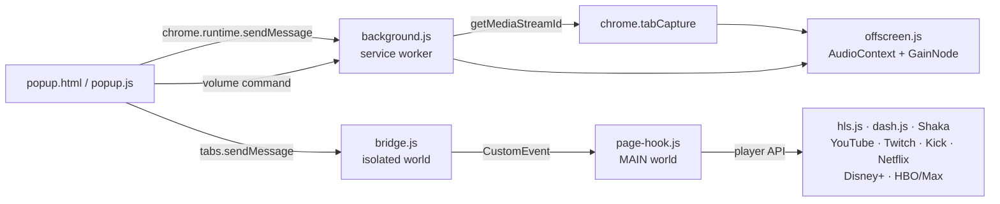

# Stream Control

[Español](README.md) · English

A Chrome/Edge Manifest V3 extension that controls **playback speed**, **quality /
bitrate** and **volume** for the video in the active tab. It is designed for
live streams with reduced latency, but it works with VOD too.

Current version: **1.5.7**. MIT licensed.



## Why it exists

Every site exposes playback differently. Instead of fighting the player, the
extension detects the engine in use and drives it through its own API whenever
one exists. If it cannot find a supported engine, it degrades silently: it does
not inject fake quality levels or break playback.

- **Speed** from 0× to 10×, with a property lock so the site cannot silently
  reset your choice. In live streams the extension knows about the live edge
  and stops accelerating once it is within 1 second of it.
- **Quality** from the variants the player actually exposes, plus **Auto**.
  The popup shows the real ceiling of the session rather than inventing steps.
- **Volume** from 0% to 600% via `chrome.tabCapture` and an `AudioContext` with
  a `GainNode` in an offscreen document, the same approach as Volume Master.
  The value is remembered per domain.
- **Live helpers**: delay/buffer readout, single "Go live" jump with a 0.5 s
  margin, and a one-shot 1.06× startup ramp limited to Shaka/DGO.
- **Experimental adapters** for Netflix, Disney+, HBO/Max, Twitch and Kick,
  with per-site debug functions.

Everything runs locally. No analytics, no remote code, no server calls.

## Install

From a release:

1. Download `stream-control-<version>.zip` from
   [Releases](https://github.com/JulianGerstner/stream-control/releases).
2. Unzip it; a `stream-control/` folder appears.
3. Open `chrome://extensions` (or `edge://extensions`) and enable
   **Developer mode**.
4. Click **Load unpacked** and select the folder that contains
   `manifest.json`.

From source: clone the repo and load the folder with `manifest.json`. The
working folder is historically named `noDelayStream`; the name is irrelevant
to Chrome.

After reloading the extension, reload the video tab too: otherwise old content
scripts keep running and the popup may report "player not found".

The extension is not listed in the Chrome Web Store yet. Icons are included in
`icons/`; the store listing and review are still pending.

## Architecture



The split is deliberate: the MAIN world can reach the player's internal API but
has no `chrome.*` permissions, while the isolated world has the extension APIs
but cannot see page internals. `bridge.js` forwards typed messages between
them. Every request carries a `requestId`, commands are sent only to the frame
that reported a player, and a third-party iframe cannot drive the main frame.

## Supported engines

| Engine | Quality source | Notes |
| --- | --- | --- |
| hls.js | `levels` | Sets `currentLevel`; Auto restores `-1`. |
| dash.js | `getBitrateInfoListFor("video")` | Disables video ABR when fixed. |
| Shaka / DGO | `getVariantTracks()` | "Maximum fixed" also pins `minHeight = maxHeight`. |
| YouTube | `getAvailableQualityLevels()` | Real formats from `playerResponse` for Shorts/embeds. |
| Twitch | Amazon IVS internal API | Preference persists in `localStorage`. |
| Kick | ARIA settings menu | Reads `[role="menuitemradio"]`, simulates pointer sequence; 3 min cache. |
| Netflix | Cadmium Stream Manager | Internal names; uses the player's own filter. |
| Disney+ | Master playlist interception | Applies on reload; preference in `sessionStorage`. |
| HBO/Max | Gluon React tree | Applied when the buffer renews (~30 s). |

## Debug

With DevTools open on the video tab:

| Function | Shows |
| --- | --- |
| `__qsSpeedDebug()` | Speed, pin, blocked reversions, live state, ramp phase |
| `__qsStillWatchingDebug()` | YouTube "Still watching?" dialog handler |
| `__qsNetflixDebug()` | Sessions, playback, streams |
| `__qsDisneyDebug()` | Intercepted master, variants, floor |
| `__qsHboDebug()` | Gluon session, variants, override |
| `__qsTwitchDebug()` / `__qsTwitchProbe()` | Twitch player / deep probe |
| `__qsKickDebug()` / `__qsKickScan()` / `__qsKickProbe()` | Kick menu and candidates |

Opt-outs: `localStorage.setItem("qs-ramp", "off")` and
`localStorage.setItem("qs-still-watching", "off")`.

## Tests

```bash
npm test          # 8 assertion scripts, no browser or dependencies
npm run check     # node --check on the five extension scripts
```

The scripts read the real source files, extract the block under test and run it
in a Node `vm` with minimal Chrome/DOM mocks. Details in [tests/README.md](tests/README.md).

## Limitations

- Experimental adapters depend on internal objects that can change without
  notice; they degrade to "not found" instead of breaking playback.
- Maximum quality depends on the plan, device, DRM and what the server signs.
  The extension does **not** bypass any of those restrictions.
- In live streams, speed is physically bounded by the available buffer.
- Volume cannot coexist with another extension already capturing the tab.
- Chromium only (Chrome/Edge); Firefox and Safari are not supported.

See [PLAN.md](PLAN.md) for the design history and release notes.

## License

MIT — see [LICENSE](LICENSE).
