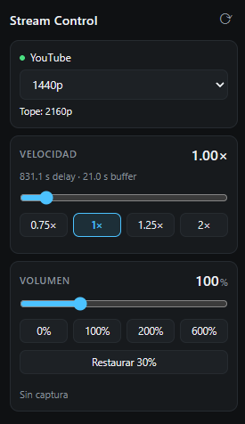
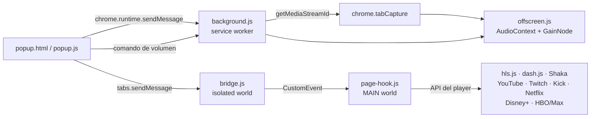

# Stream Control

Extensión de Chrome (Manifest V3) para controlar el reproductor de video de la
pestaña activa: **velocidad**, **calidad/bitrate** y **volumen**. Está pensada
para ver **transmisiones en vivo** con el menor delay posible, pero también
funciona en VOD.

La idea central es no pelear contra el reproductor: la extensión detecta el
motor que usa el sitio (hls.js, dash.js, Shaka, YouTube, Twitch, Netflix,
Disney+ o HBO/Max) y usa su API cuando existe. Si no la encuentra, degrada sin
romper la reproducción.

Versión actual: **1.5.7**. Licencia MIT.

[English](README.en.md)



---

## Qué hace

- **Velocidad** de 0× a 10×, con candado sobre la velocidad elegida para que el
  sitio no la revierta.
- **Calidad** por resolución o bitrate, con opción **Auto**, en los motores que
  la exponen.
- **Volumen** de 0% a 600% capturando el audio de la pestaña (igual que Volume
  Master).
- **Ajustes para vivo**: muestra delay y buffer, permite saltar al borde del
  vivo y hace un ajuste único de velocidad al inicio de la transmisión.
- **Selectores experimentales** para Netflix, Disney+, HBO/Max y Twitch, con
  diagnóstico integrado.

---

## Instalación (modo desarrollador)

1. Abrí Chrome y entrá a `chrome://extensions`.
2. Activá **Modo de desarrollador** (arriba a la derecha).
3. Tocá **Cargar descomprimida** y elegí la carpeta que contiene
   `manifest.json`. En un ZIP de Release se llama `stream-control`; si clonás
   el repo, la carpeta histórica es `noDelayStream`.
4. Abrí un video, dale play y hacé clic en el ícono de la extensión.

En Edge es igual: `edge://extensions` → Modo de desarrollador → Cargar
descomprimida.

> **Al actualizar la extensión**, después de tocar ⟳ en `chrome://extensions`,
> recargá también la pestaña del video. Si no, quedan content scripts viejos
> corriendo y el popup puede decir que no encontró el reproductor.
>
> Si ya tenías otra copia de Stream Control cargada, quitá la anterior: dos
> copias activas sobre el mismo video se pisan.

---

## Uso rápido

1. Reproducí el video y abrí el popup.
2. Arriba aparece el motor detectado. Si no aparece, probá el botón **⟳** o
   recargá la pestaña.
3. Movés la velocidad, elegís calidad o subís el volumen. El cambio se aplica
   según el motor: la mayoría es inmediato; Disney+ recarga la pestaña, Netflix
   reinicia el streaming y HBO/Max espera a que se renueve el buffer.

El popup tiene tres tarjetas:

- **Reproductor / Calidad**: motor detectado, selector con las calidades
  alcanzables y el tope real de la sesión.
- **Velocidad**: valor actual, slider, atajos y estado del vivo.
- **Volumen**: porcentaje, slider, presets y estado de la captura.

Cuando la velocidad está fijada por vos, al lado del valor aparece **fijada**.
Ese es el estado normal: la extensión defiende tu elección.

---

## Velocidad

### Controles

- **Slider**: de 0% a 1000%, en pasos de 5% (0,05×).
- **Atajos**: 0,75×, 1×, 1,25× y 2×.
- **1×** también es una elección explícita: queda fijada y el sitio no la puede
  cambiar.

### La velocidad que elegís manda

Al elegir una velocidad, la extensión:

- fija `playbackRate` y `defaultPlaybackRate` con un candado de propiedad;
- reafirma el valor cada 250 ms si algo lo cambia;
- bloquea los intentos del propio reproductor de imponer otra velocidad;
- en Twitch/Kick también le avisa al player interno, para que su estado no quede
  desincronizado del `<video>`.

El popup muestra **fijada** y, al pasar el mouse, cuántas veces el sitio intentó
cambiar la velocidad. Mientras el candado está activo, el selector de velocidad
nativo del sitio también queda bloqueado: para cambiarla, usá el popup.

Si el sitio insiste, la extensión sigue defendiendo tu elección: no la suelta
sola. El popup cuenta los intentos bloqueados para que sepas que hubo pelea.

La elección sobrevive a cambios de `<video>` dentro de la misma página (nuevo
episodio, anuncio, reproductor recreado), pero **se pierde al recargar la
pestaña**.

### En vivo

El popup muestra el **delay** (distancia al borde del vivo) y el **buffer**
(video ya descargado por delante).

- Acelerar solo sirve hasta el borde del vivo. Con **1 segundo o menos** de
  delay, la extensión reproduce a 1× aunque hayas pedido más: más rápido que el
  vivo no se puede.
- Si el delay vuelve a superar los **3 segundos**, retoma la velocidad pedida.
- En VOD no hay borde del vivo: la velocidad elegida se aplica de forma normal.

### Ajuste único de arranque (rampa)

En vivos con segmentos largos, la extensión puede hacer un único ajuste al
principio:

1. Mide el tamaño de la ráfaga observando cada cuánto crece el buffer.
2. Cuando hay ~2 ráfagas buffereadas, pone **1,06×**.
3. Al bajar a ~1,3 ráfagas, vuelve a **1,00×** y no toca más la velocidad.

Condiciones:

- **Solo se activa en Shaka/DGO**, el motor para el que fue diseñada. En
  YouTube, Twitch, Kick, hls.js, dash.js y el resto de los motores nunca cambia
  la velocidad por su cuenta.
- Solo se activa con vivo confirmado por el player durante al menos 3 segundos.
- No se activa si la ráfaga medida es menor a 3 segundos (Twitch, por ejemplo:
  ahí el buffer ya es corto).
- No se activa si vos elegiste una velocidad.
- Al cambiar de fuente (otro video o episodio) la rampa se cancela, se vuelve a
  1× y se vuelve a medir desde cero.
- Tiene un tope de seguridad de 180 segundos.
- Nunca deja menos de 3,5 segundos de buffer por delante.

Para desactivarla del todo, en la consola de la pestaña:

```js
localStorage.setItem("qs-ramp", "off")
```

Con `qs-ramp` en `0`, `off` o `false` la rampa no se ejecuta en ese sitio. Para
volver a habilitarla: `localStorage.removeItem("qs-ramp")`.

### Ir al vivo

El botón **Ir al vivo** aparece solo en transmisiones en vivo. Hace un único
salto hacia adelante dentro del buffer, dejando 0,5 segundos de margen para que
el player no se quede sin datos. Si ya hay 1 segundo o menos de buffer por
delante, avisa que ya estás al día.

Es la forma recomendada de recortar atraso sin pelear con el control de latencia
del reproductor. Cada salto puede dejar un instante de audio cortado mientras se
rellena el buffer, igual que el botón nativo de "ir al vivo".

### Cartel "¿Sigues viendo?" (YouTube / YouTube Music)

YouTube pausa la reproducción después de un rato sin interacción y muestra un
diálogo para confirmar que seguimos ahí. La extensión lo detecta y lo confirma en
cuanto aparece (normalmente en menos de un segundo). Si el video quedó pausado,
además lo reanuda.

- Actúa **solo en `youtube.com` y `music.youtube.com`**, en el frame principal.
- No reanuda nada que hayas pausado vos: solo interviene cuando apareció el
  cartel.
- Si YouTube cambia el diálogo, no encuentra nada y sigue igual: no rompe la
  reproducción.
- Para desactivarlo, en la consola de la pestaña:

  ```js
  localStorage.setItem("qs-still-watching", "off")
  ```

  Con `0`, `off` o `false` deja de actuar. Para volver:
  `localStorage.removeItem("qs-still-watching")`.

- Diagnóstico: `__qsStillWatchingDebug()` muestra si está activo, cuántos carteles
  confirmó, cuántas reanudaciones hizo y el último error.

### Limitaciones

- En vivo, una velocidad alta sostenida no es posible: el player la revierte al
  llegar al borde.
- Si el player no permite escribir `playbackRate`, la velocidad no se puede
  aplicar; el popup muestra la velocidad real del video.
- El control no aplica a anuncios de forma confiable.
- Al recargar la página se pierde el candado y vuelve la velocidad del sitio.

---

## Calidad

El popup lista **solo calidades alcanzables**: las que el reproductor realmente
expone y, cuando hay un filtro de por medio (Netflix, HBO/Max), las que ese
filtro permite. No se inventan escalones ni se muestran resoluciones que el
servidor no mandó. Debajo del selector aparece el **techo real de la sesión**
(`Cuenta: hasta 1080p` en Netflix o `Tope: 1080p` en el resto, según el motor),
calculado sobre esa misma lista. **Auto** siempre está disponible para devolverle
la decisión al ABR. Según el motor, también puede haber opciones extra como
**Máxima fija** o topes por altura.

### hls.js

Lista los niveles del manifest (`levels`), con resolución o bitrate como
etiqueta. Elegir uno fija `currentLevel` y lo mantiene; **Auto** vuelve a
`currentLevel = -1`.

### dash.js

Lista los bitrates de video (`getBitrateInfoListFor("video")`). Elegir uno apaga
el ABR de video y fija esa calidad; **Auto** vuelve a encender
`autoSwitchBitrate`.

### Shaka / DGO

Lista las variantes de video (`getVariantTracks()`), sin repetir etiquetas.

- **Elegir una resolución** deja un escalón de margen hacia abajo. Si el encoder
  recorta la escalera en vivo, el ABR puede caer al escalón siguiente en vez de
  quedarse sin variante válida. El techo sigue siendo la resolución elegida.
- **Máxima fija** es distinto: apaga el ABR, selecciona la variante más alta con
  `selectVariantTrack(track, true)` y deja `minHeight = maxHeight` en las
  restricciones como segunda barrera. Hace un corte puntual de buffer para
  aplicar el cambio ya.
- **Auto** borra las restricciones y vuelve a encender el ABR.

> **Máxima fija** puede provocar buffering si la red no sostiene ese bitrate: no
> baja de calidad a propósito. Es una decisión explícita, no el comportamiento
> por defecto.

### YouTube

Lista las calidades disponibles del player (`getAvailableQualityLevels`) y las
aplica con `setPlaybackQuality` y `setPlaybackQualityRange`. En Shorts o embeds
que solo exponen `auto`, arma la escalera con los formatos reales del
`playerResponse`.

### Twitch (experimental)

Usa la API interna del player (Amazon IVS, accesible vía React), no el menú de
la interfaz. Lista las calidades reales del stream, permite **Auto** y guarda la
elección en `localStorage` (`video-quality`, `quality-bitrate`,
`video-quality-highest-available`) para que Twitch la respete al recargar.

### Kick (experimental)

Kick no expone hls.js, Shaka ni una API de calidad: su player es propio y la
única fuente real es el **menú ⚙️**, hecho con primitivas ARIA. El adapter lee
las opciones del menú (`[role="menuitemradio"]` y `aria-checked`) y las aplica
simulando la secuencia completa de puntero, porque el menú ignora un `.click()`
pelado. La lista se ordena de mayor a menor y debajo aparece
`Máx. del stream: 1080p60` (Kick no tiene planes: el techo es el del stream).

Detalles:

- **Leer la lista abre el menú** un instante (se cierra solo). Se cachea 3
  minutos por URL, así que abrir el popup varias veces seguidas no lo reabre.
- Los fracasos **no** se cachean: si la primera lectura cae mientras el player
  todavía carga, el popup reintenta una vez a los 1,5 s.
- Kick tiene varios botones con `aria-haspopup="menu"` (subtítulos, audio,
  ajustes). El adapter elige por nombre/ícono de ajustes y, si no hay, por
  cercanía a la esquina inferior derecha, descartando subtítulos/CC/audio/
  idioma. Si aun así el botón abre el menú equivocado, lo detecta, lo cierra y
  prueba el siguiente candidato (hasta 3) antes de rendirse.
- Elegir una calidad abre el menú, hace click en la opción y verifica
  `aria-checked`. Si el menú no aparece o cambió, el selector cae a **Auto** y
  el resto de la extensión sigue funcionando.
- La elección **no** se re-aplica sola al recargar ni al cambiar de canal: eso
  implicaría abrir el menú sin que lo pidas.
- Diagnóstico: `__qsKickDebug()` (no abre el menú) y `__qsKickScan()` (fuerza
  una lectura y devuelve las etiquetas). Si el popup avisa que no pudo leer el
  menú, `__qsKickProbe()` muestra videos, botones candidatos, menús y opciones
  sin tocar nada; `__qsKickProbe(true)` intenta abrirlo y reporta el motivo.

### Netflix (experimental)

La API pública de Cadmium (`videoPlayer`) solo permite play/pause/seek/volumen y
pistas de audio. No expone bitrate. El adapter llega al **Stream Manager**
interno (`playback.playbackStreamManager`), filtra la lista de variantes y llama
a `restartStreaming()` para aplicar el cambio, el mismo camino que usa el menú
de debug nativo de Netflix.

El popup muestra **una entrada por bitrate** (con resolución y Mbps cuando están
disponibles) y **Auto**, que borra el filtro y reinicia el streaming. En Netflix
**no** hay "Máxima fija": se elige un bitrate concreto o Auto. Solo se listan las
variantes que el filtro del player permite: si el plan o el equipo bloquean 4K,
esas entradas no aparecen. Debajo del selector, `Cuenta: hasta 1080p` indica el
techo de la cuenta; `Tope: 1080p (2160p bloqueado)` indica que hay variantes más
altas que el player no puede usar en esta sesión.

Advertencias:

- Es **experimental**: depende de nombres internos del player que cambian entre
  builds de Netflix.
- Va **contra los Términos de Servicio** de Netflix (reverse engineering).
- Aplicar un bitrate reinicia el streaming; puede haber un corte breve.
- Para 4K en Chrome hacen falta Windows 11, Chrome 117 o superior, plan Premium,
  HDCP 2.2, pantalla 4K y decodificación HEVC por hardware. En macOS, Chrome
  sigue limitado a 1080p.
- Si falla, el popup muestra qué pieza no encontró y podés usar
  `__qsNetflixDebug()` en la consola. El menú nativo de Netflix
  (`Ctrl+Alt+Shift+S` o `Ctrl+Alt+Shift+D`) sirve como referencia, no lo abre la
  extensión.

### Disney+ (experimental)

Disney+ no usa hls.js, dash.js ni Shaka: el player es propio y **la calidad se
decide al crear la sesión**, cuando pide el master playlist. Por eso el adapter
intercepta el master y deja solo las variantes permitidas. Como el master se pide
una sola vez por sesión, **elegir una calidad recarga la pestaña** (Disney+
reanuda por bookmark). La preferencia vive en `sessionStorage` y sobrevive a la
recarga.

Opciones:

- **Auto (mín. 720p)**: ABR normal, pero sin variantes por debajo de 720p.
- **Una entrada por variante real** (`720p · 4,3 Mbps`): fija ese bitrate exacto.
- **`720p (ABR)`**: deja que el ABR elija el bitrate dentro de esa altura. Es la
  opción más segura para fijar resolución.

Si el interceptor no llegó a leer el master, el selector muestra **solo Auto** en
lugar de una escalera inventada. El techo real en Chrome/Edge suele ser 720p: el
back-end firma la sesión con `r=720` y el master crudo solo trae 720/480/360. No
es una limitación del adapter. Forzar más implicaría saltear DRM o plan y queda
fuera de alcance.

Para diagnóstico por pestaña (requiere recargar):

```js
sessionStorage.setItem("qs-disney-floor", "0"); // apaga el piso de 720p en Auto
sessionStorage.setItem("qs-disney-uncap", "1"); // pide el master sin tope (sondeo manual)
```

El destope ya no se ofrece como botón: es un sondeo manual. Si el back-end
entrega 1080p, el ABR puede usarlo; si no, el video se queda en 720p.

Elegir **480p** o **360p** a mano tiene prioridad sobre el piso de Auto y es la
salida para redes lentas.

### HBO/Max (experimental)

El player vive en el árbol de React (motor **Gluon**) y no en `window`. El
adapter encuentra la sesión, lista las variantes que el motor realmente permite
en este equipo y las aplica por dos vías:

- **Variante exacta**: fija el bitrate con `setBitrateOverride`.
- **`720p (ABR)`**: pone un techo de bandwidth para esa altura y deja que el ABR
  elija dentro de ella.
- **Auto**: borra el override y el techo; vuelve a decidir el ABR.

El cambio se aplica cuando se renueva el buffer, así que puede tardar hasta ~30
segundos. La opción elegida queda marcada mientras tanto. Si falla, usá
`__qsHboDebug()` en la consola.

---

## Volumen

El volumen funciona por **captura del audio de la pestaña** (`chrome.tabCapture`)
y un `AudioContext` con `GainNode` en un documento offscreen. Chrome silencia la
salida normal de la pestaña mientras dura la captura: el audio audible pasa a ser
el que procesa la extensión.

- Rango: **0% a 600%**.
- El slider tiene precisión fina en valores bajos (0–9 de a 1) y después va de 10
  en 10 hasta 600.
- Presets: **0%, 100%, 200%, 600%**.
- Teclas **0** y **1–6**: ponen 0% y 100%–600%.
- Rueda del mouse sobre el slider: un paso por vez.
- El ícono de la extensión muestra el porcentaje aplicado como badge.
- **Restaurar X%**: vuelve al último volumen guardado para ese dominio.
- **Detener**: libera la captura y devuelve el audio normal de la pestaña.

El volumen se recuerda **por dominio** en `chrome.storage.local`. Al volver a ese
sitio aparece la opción de restaurarlo.

Condiciones y límites:

- La captura se activa al mover el slider, tocar un preset o usar una tecla con
  el popup abierto (Chrome exige un gesto de usuario).
- Solo puede haber **una captura por pestaña**. Si otra extensión (por ejemplo
  Volume Master) ya está capturando ese audio, Stream Control avisa y no toca el
  audio.
- En páginas protegidas (`chrome://`, Chrome Web Store, etc.) la captura no está
  disponible.
- Si recargás la extensión o Chrome corta el stream, la captura termina y hay que
  volver a activarla.
- **Si la pestaña navega a otra URL, la captura se detiene sola**, aunque el
  `tabId` sea el mismo. Hay que volver a activarla desde el popup: así un video
  no sigue capturando el audio si después abrís una llamada en esa pestaña.

---

## Diagnóstico

Con la consola de DevTools abierta en la página del video:

| Comando | Qué muestra |
| --- | --- |
| `__qsSpeedDebug()` | velocidad pedida/real, pin, reversiones bloqueadas, `live`, fase/motivo de la rampa y si está desactivada |
| `__qsNetflixDebug()` | estado de sesiones, playback, streams y video |
| `__qsDisneyDebug()` | master interceptado, variantes, piso y destope |
| `__qsHboDebug()` | sesión Gluon, variantes, selección y override |
| `__qsTwitchDebug()` | player de Twitch, calidades y selección |
| `__qsTwitchProbe()` | búsqueda profunda del player si el anterior falla |
| `__qsKickDebug()` | menú leído, cache de calidades y `<video>` de Kick |
| `__qsKickScan()` | fuerza una lectura del menú de Kick y lista etiquetas |
| `__qsKickProbe()` | videos, botones, menús y opciones que ve el adapter |
| `__qsKickProbe(true)` | intenta abrir el menú y reporta en qué paso falló |
| `__qsYouTubeDebug()` | players de YouTube, calidades y formatos reales |
| `__qsStillWatchingDebug()` | estado del confirmador del cartel "¿Sigues viendo?" |

El popup muestra un aviso corto en las plataformas experimentales. Si el
selector no encuentra lo que necesita, agrega el diagnóstico de la pieza que
falta. Ese texto es la primera pista para saber si el sitio cambió el player.

---

## Permisos

- `activeTab`: acceso temporal a la pestaña al hacer clic en la extensión.
- `webNavigation`: enumerar los frames de la pestaña y hablar con el que tiene
  el reproductor.
- `tabCapture`: capturar el audio de la pestaña para el control de volumen.
- `offscreen`: mantener el `AudioContext` vivo fuera del popup.
- `storage`: recordar el volumen por dominio.
- `host_permissions: ["<all_urls>"]`: los content scripts tienen que poder
  detectar reproductores en cualquier sitio.

La extensión **no envía datos a ningún servidor**, no usa analíticas y no carga
código remoto. Todo el procesamiento es local.

---

## Seguridad y mensajería

- El **popup es el único** que puede pedir captura de audio al service worker.
  Se valida el emisor (`sender.id` y URL del popup) antes de aceptar un comando
  de `nds-volume-set`, `stop` o `get`.
- El popup usa la **pestaña activa real** para el volumen: si cambiás de pestaña
  con el popup abierto, el slider no silencia la pestaña anterior.
- Cada pedido al reproductor lleva un **`requestId`**. El puente ignora
  respuestas de otros pedidos y los comandos de velocidad/calidad se envían solo
  al frame que reportó tener el reproductor. Un iframe de terceros no puede
  inducir a la extensión a cambiar la calidad del frame principal.
- Los datos que vienen de una página (delay, buffer, calidades, avisos) se
  validan por tipo y se limitan en tamaño antes de mostrarse: un valor inesperado
  no rompe el popup.
- El `tabId` se comprueba contra Chrome y debe ser http(s); el offscreen valida
  el emisor, exige un `tabId` entero y un `streamId` no vacío, y no reutiliza un
  `streamId` ya usado.
- Los cambios de calidad en Disney+ que terminan en recarga se **agrupan**: como
  máximo una recarga cada 10 segundos.

No hay `externally_connectable`, así que un sitio web no puede llamar directamente
a la API interna de la extensión. Estas comprobaciones son defensa en profundidad.

---

## Arquitectura



La separación es a propósito: el MAIN world ve la API interna del reproductor
pero no tiene permisos `chrome.*`; el mundo aislado tiene las APIs de la
extensión pero no ve el player. `bridge.js` pasa mensajes tipados entre ambos.
Cada pedido lleva `requestId`, los comandos van solo al frame que reportó tener
reproductor y un iframe de terceros no puede manejar el frame principal.

---

## Archivos

- `manifest.json` — configuración MV3, permisos y content scripts.
- `background.js` — service worker: pide el `streamId`, crea el documento
  offscreen, serializa los pedidos por pestaña y detecta capturas ajenas.
- `offscreen.html` / `offscreen.js` — `AudioContext` + `GainNode` por pestaña.
- `page-hook.js` — corre en el MAIN world: detecta el reproductor, controla
  calidad, velocidad y ajustes de vivo, e instala los adapters experimentales.
- `bridge.js` — puente de mensajes entre la página y el popup.
- `popup.html` / `popup.css` / `popup.js` — interfaz del ícono.
- `PLAN.md` — arquitectura, alcance y checklist de pruebas.

---

## Limitaciones honestas

- Los selectores de **Netflix, Disney+, HBO/Max y Twitch** son experimentales:
  dependen de objetos internos que pueden cambiar sin aviso. Si eso pasa,
  degradan a "no encontrado" sin romper la reproducción.
- La calidad máxima depende del plan, del dispositivo, del DRM y de lo que el
  servidor firme. La extensión no saltea ninguna de esas restricciones.
- En vivo, la velocidad está limitada físicamente por el buffer disponible.
- La detección de vivo depende de la API del player; si el sitio la cambia, se
  usa `duration` como respaldo y un vivo con ventana DVR podría no detectarse.
- El control de velocidad no es confiable en anuncios.
- El volumen no puede convivir con otra extensión que ya capture esa pestaña.
- Es una extensión para Chrome/Edge (Chromium). No está pensada para Firefox ni
  Safari.

---

## Desarrollo

No hay build ni dependencias: son archivos estáticos. Los tests tampoco
necesitan navegador: leen el código real y lo ejecutan en un `vm` de Node con
mocks mínimos (ver `tests/README.md`).

```bash
npm test          # 8 scripts con asserts
npm run check     # node --check en los 5 JS
```

Para probar cambios:

1. Guardá los archivos.
2. En `chrome://extensions`, tocá ⟳ en Stream Control.
3. Recargá la pestaña del video.
4. Abrí el popup y revisá el motor detectado.

Los iconos ya están en `icons/`. Para la Chrome Web Store falta el alta y la
revisión de la lista; mientras tanto se instala desde un Release en modo
desarrollador.
